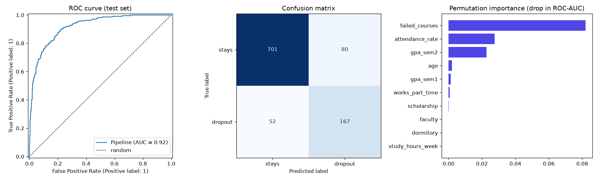

# Student Dropout Risk Predictor
[](https://github.com/damir126/student-risk-predictor/actions/workflows/ci.yml)

> **Course:** Machine Learning / Data Science (4th year)

An end-to-end machine learning project: from data to a production-ready **REST API in Docker**.
The model estimates the probability that a student will drop out, so an academic advisor can
step in *early* — and the API also explains which risk factors to act on.



## Results (held-out test set, 1 000 students)

| Metric | Value |
|---|---|
| ROC-AUC | **0.921** |
| PR-AUC | 0.794 |
| F1 (dropout class) | 0.717 |
| Recall (dropout class) | 0.76 — 3 out of 4 students at risk are found |

5-fold cross-validation on the training set (model selection):

| Model | ROC-AUC | F1 |
|---|---|---|
| **Logistic regression** | **0.932 ± 0.003** | 0.720 |
| Random forest | 0.924 ± 0.004 | 0.707 |
| Gradient boosting | 0.918 ± 0.007 | 0.706 |

The simplest model won: the relationships in this data are close to linear, and logistic regression
is also the easiest model to explain to non-technical users. The most important factors are
**failed courses, attendance and last-semester GPA**.

## ML workflow

1. **Data** — 5 000 student records with 13 model features (see note below)
2. **Split** — 80/20 stratified train/test; the test set is used only once, at the very end
3. **Pipeline** — `ColumnTransformer` (scaling + one-hot encoding) inside an sklearn `Pipeline`,
   so the same preprocessing runs in training, cross-validation and the API (no data leakage)
4. **Model selection** — 3 models compared with stratified 5-fold CV
5. **Threshold tuning** — the decision threshold is chosen on a separate validation split to maximize F1
   (classes are imbalanced: ~22% dropout, so 0.5 is not optimal)
6. **Evaluation** — ROC/PR curves, confusion matrix, classification report
7. **Explainability** — permutation importance + rule-based recommendations in the API
8. **Serving** — FastAPI with strict input validation, batch endpoint, OpenAPI docs, Docker image

> **About the data.** Real student records are personal data and cannot be published.
> The dataset is therefore **synthetic**: `riskml/data.py` generates it from a documented process based on
> typical findings in educational research. The same pipeline works with a real CSV:
> `python -m riskml.train --data students.csv`.

## API

```bash
pip install -r requirements.txt
python -m riskml.train                 # trains and writes models/ and reports/
uvicorn riskml.api:app --reload        # Swagger UI: http://localhost:8000/docs
```

```bash
curl -X POST localhost:8000/predict -H "Content-Type: application/json" -d '{
  "age": 20, "faculty": "computer_science", "tuition": "contract",
  "scholarship": "no", "works_part_time": "yes", "dormitory": "no", "commute_minutes": 70,
  "admission_score": 128.5, "attendance_rate": 0.61, "study_hours_week": 4,
  "gpa_sem1": 3.1, "gpa_sem2": 2.7, "failed_courses": 3 }'
```

```json
{
  "dropout_probability": 0.9026,
  "at_risk": true,
  "risk_level": "high",
  "recommendations": [
    "Attendance is below 75%: contact the student and the group curator.",
    "Several failed courses: plan retakes and offer tutoring.",
    "Works part-time and studies little: discuss a flexible schedule.",
    "Contract student with low grades: inform about payment plans and grant options."
  ]
}
```

| Method | Endpoint | Description |
|---|---|---|
| GET | `/health` | liveness check |
| GET | `/model` | model name, threshold, test metrics |
| POST | `/predict` | one student |
| POST | `/predict/batch` | up to 1 000 students |

Invalid input (e.g. `attendance_rate: 1.7` or an unknown faculty) is rejected with `422` and a clear message.

## Docker

```bash
docker build -t dropout-api .      # the model is trained during the build
docker run -p 8000:8000 dropout-api
```

## Tests

```bash
python -m unittest discover -s tests -v
```

Tests train a model on a small dataset and check data validity, minimum model quality (ROC-AUC > 0.8),
that the important features make sense, and the API (predictions, batch, validation errors).

## Ethics

A model like this must support people, not replace them: predictions go to an advisor who talks
to the student; they are never used to punish or to make automatic decisions. Gender is present in the
dataset but deliberately **not used by the model**; it is kept only so that predictions can be
**checked for bias** between groups.
